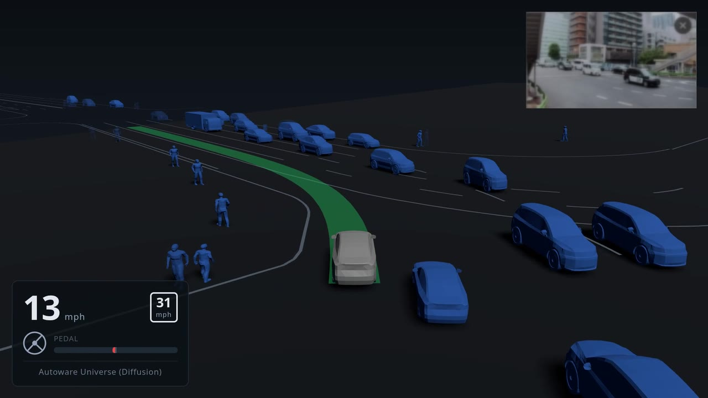
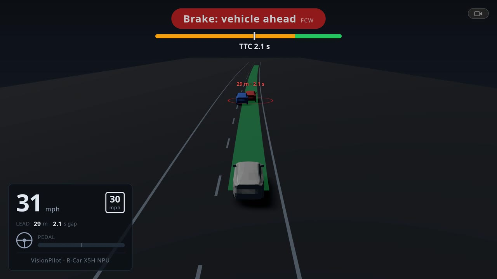

# ADAS dashboard

A browser page that shows what an automated driving stack sees, plans and does. It is for people who are not engineers, for example visitors at a trade show booth. The page takes a small set of JSON messages over WebSocket, so any driving stack, vehicle or map can feed it.

The Autoware Foundation and MulticoreWare develop the dashboard together. MulticoreWare built the page. The Autoware Foundation side wrote the message schema, the tools and the adapters.

| Autoware Universe Diffusion Planner on a recorded drive                                                          | VisionPilot warning before automatic emergency braking                                                          |
| ---------------------------------------------------------------------------------------------------------------- | --------------------------------------------------------------------------------------------------------------- |
|  |  |

## What the page shows

- The objects that the stack perceives, as 3D models of cars, trucks, buses, trailers, pedestrians, cyclists and bicycles.
- The planned trajectory as a green ribbon, the lane lines that the stack perceives, and the lane lines of the map.
- The ego vehicle with its speed, the speed limit, the gap to the lead vehicle, the steering and the pedal.
- Alerts at their cause: a red ring on the lead vehicle, a red trajectory or a red lane line, with a short text at the top.
- A warning before automatic emergency braking (AEB). The page computes the time to collision (TTC) to the lead vehicle and warns below 3 s.
- Who controls the car: the stack, a supervisor such as a Safety Island or an Autoware minimal risk maneuver (MRM), or the driver.
- A camera picture in a small window at the top right.

The page has six states: Connecting, Driving, Alert, Stack lost, Takeover and Stopped. If the stack endpoint closes, the page shows "Stack lost". If a supervisor takes control, the page frame turns amber. Section 6 of [docs/design.md](docs/design.md) describes each state.

## Inputs and outputs

```text
driving stack ── stack ──────┐
vehicle ──────── vehicle ────┤  JSON over WebSocket
map ──────────── map ────────┼───────────────────────▶ browser page
supervisor ───── supervisor ─┘
camera ───────── HTTP stream or web page ────────────▶ camera window
```

The page connects to one or more WebSocket endpoints. Each endpoint sends a `hello` message first, and the `hello` lists the roles of the endpoint. One endpoint can carry more than one role. The page sends no commands back.

| Role         | Messages                                             | Typical source                                         |
| ------------ | ---------------------------------------------------- | ------------------------------------------------------ |
| `stack`      | `objects`, `lanes`, `trajectory`, `alerts`, `status` | the perception and planning of the driving stack       |
| `vehicle`    | `ego`                                                | a simulator, the localization of a stack, a CAN bridge |
| `map`        | `map`                                                | a simulator map, a Lanelet2 map, an HD map             |
| `supervisor` | `control`, `status`, `alerts`                        | a Safety Island, an Autoware MRM, a driver takeover    |

Each message type has a JSON Schema in [schema/v1/](schema/v1/) and an example in [schema/v1/examples/](schema/v1/examples/). Section 5 of [docs/design.md](docs/design.md) gives the fields, the units and the coordinate frames.

### Sources that work today

| Source                                                                 | Roles           | Code                                               | Tested with                                          |
| ---------------------------------------------------------------------- | --------------- | -------------------------------------------------- | ---------------------------------------------------- |
| VisionPilot on a Renesas R-Car X5H board                               | `stack`         | in the VisionPilot code, not in this repository    | live runs on the CES 2027 bench                      |
| CARLA 0.10 simulator                                                   | `vehicle`,`map` | [adapters/carla/](adapters/carla/)                 | live runs on the CES 2027 bench                      |
| Safety Island on the Cortex-R52 core of the board                      | `supervisor`    | [adapters/safety_island/](adapters/safety_island/) | live runs on the CES 2027 bench                      |
| Autoware Universe, live                                                | all four        | [adapters/autoware/](adapters/autoware/)           | rule-based Autoware in closed loop in CARLA Town10HD |
| Autoware Universe on a recorded drive, with only the planner run again | all four        | [adapters/autoware/](adapters/autoware/)           | the Diffusion Planner on a recorded real-world drive |
| Recorded or generated JSONL files                                      | any             | [tools/replay.py](tools/replay.py)                 | the recordings in [recordings/](recordings/)         |
| A ROS image topic, through `web_video_server`                          | camera window   | [adapters/carla/camera/](adapters/carla/camera/)   | the CARLA and Autoware runs                          |

The camera window shows the URL in `camera_url`, for example an MJPEG stream or a web page. The videos of these runs are in [issue #1](https://github.com/autowarefoundation/adas-dashboard/issues/1).

### Outputs

- The page. `npm run build` writes a static folder, `dist/`, that any HTTP server can serve. The page runs in Chrome and Firefox.
- Recordings. `tools/record.py` writes the messages of each live endpoint to a JSONL file. `tools/replay.py` plays the file again with the original timing.
- Schema validation. `tools/schema.py` validates each message against the schema.

## Try it without hardware

You need Node 22 or newer and Python 3.12.

1. Install the dependencies:

   ```sh
   npm ci
   python3 -m venv .venv
   . .venv/bin/activate
   pip install -r tools/requirements.txt
   ```

2. Play the generated recording of the kill route:

   ```sh
   python3 -m tools.replay stack=recordings/ces2027-kill-route/stack.jsonl:8090 world=recordings/ces2027-kill-route/world.jsonl:8091
   ```

3. In a second terminal, start the page, then open <http://localhost:5173>:

   ```sh
   npm run dev
   ```

The kill route plays once through all six states, in the order of design section 6.3. Connecting comes before the replay answers. Driving follows, with a lane departure warning at 12 s and a forward collision warning at 23 s. Stack lost comes at 40 s, Takeover at 40.5 s and Stopped about a second after the car halts. Stopped holds until the stack reports `active` again, so restart the replay to see the fade back to Driving.

The stack file ends at 40 s and its port then stops accepting connections, which is how the page sees "Stack lost". The world file keeps playing to 55 s. To watch the run again, restart the command.

To see the warning before automatic emergency braking, play the cut-out recording instead:

```sh
python3 -m tools.replay stack=recordings/ces2027-cut-out/stack.jsonl:8090 world=recordings/ces2027-cut-out/world.jsonl:8091
```

[recordings/README.md](recordings/README.md) describes each recording, including a live run of the bench.

`--loop` gives an endless loop instead. It is useful for camera and mesh work, but never shows the kill. No endpoint closes under `--loop`. The stack file is 40 s and the world file is 55 s, so the two drift 15 s further apart every cycle. If the browser is not on the machine that runs the replay, add `--host 0.0.0.0`.

## Connect your own stack

Your software sends JSON messages from a WebSocket server. This Python program is a complete `stack` endpoint. It sends one car 25 m ahead and a straight plan, ten times per second:

```python
import asyncio
import json
import time

import websockets


def msg(kind, **fields):
    return json.dumps({"source": "mystack", "type": kind, "t_ms": time.monotonic() * 1000, **fields})


async def stack(ws):
    await ws.send(msg("hello", schema=1, roles=["stack"], name="My stack", device="laptop"))
    while True:
        await ws.send(msg("status", name="My stack", mode="active"))
        await ws.send(msg("trajectory", frame="ego", pts=[[x, 0.0] for x in range(0, 40, 2)]))
        car = {"id": 1, "class": "car", "x": 25.0, "y": 0.0, "yaw": 0.0,
               "length": 4.5, "width": 1.9, "height": 1.5, "lead": True, "distance_m": 21.0}
        await ws.send(msg("objects", frame="ego", objects=[car]))
        await asyncio.sleep(0.1)


async def main():
    async with websockets.serve(stack, "127.0.0.1", 8090):
        await asyncio.Future()  # serve until Ctrl-C


asyncio.run(main())
```

To try it, do these steps:

1. Install `websockets`. `pip install -r tools/requirements.txt` installs it.
2. Run the program. It listens on port 8090, the `stack` port of the default `public/config.json`.
3. Start the page with `npm run dev` and open <http://localhost:5173>.

The page shows the lead car in red with its distance, the green plan and "My stack" in the status panel. Then add to it:

- Send each message type that your software can fill. The files in [schema/v1/examples/](schema/v1/examples/) show every field.
- Send positions in the `ego` frame or in the `map` frame. The `ego` frame is x forward, y left, with its origin at the center of the rear axle. If no `vehicle` endpoint sends `ego` with `pose_map`, the page does not draw `map` frame geometry.
- Record your endpoint for 10 s, then make sure that every message passes the schema:

  ```sh
  python3 -m tools.record --out recordings/my-run --seconds 10 stack=ws://127.0.0.1:8090/stack
  python3 -m tools.schema recordings/my-run/stack.jsonl
  ```

- Point the page at your endpoints in `config.json`, or with URL parameters such as `?stack=ws://192.168.0.20:8090/stack`.

For a ROS 2 stack, start from the Autoware adapter in [adapters/autoware/](adapters/autoware/). It reads ROS 2 topics with `rclpy` and serves three endpoints. [adapters/ws.py](adapters/ws.py) has the WebSocket endpoint class that the adapters share.

## Run the page for a demo

1. Build the page with `npm run build`.
2. Edit `dist/config.json`. Set the endpoint URLs and `camera_url`.
3. Serve the folder, for example with `python3 -m http.server 8070 -d dist`.
4. Open the page in Chrome or Firefox, then press `f` for fullscreen.

Do not serve the page on port 8000 of a CARLA host, because the CARLA Traffic Manager uses that port.

The page reads `config.json` next to `index.html`. The default file points at the ports 8090, 8091 and 8092. Query parameters override it key by key: `?stack=ws://...` sets an endpoint, `?units=km/h` and `?theme=light` set those keys, and `?camera.chase.pitch_deg=30` sets one camera preset value. `fcw_ttc_s` sets the TTC below which the page warns, 3.0 s by default. Point `camera_url` at any URL. Its default is a `web_video_server` stream of the CARLA camera on port 8080. Without that server, the camera window shows "camera lost".

The operator keys are:

| Key      | Action                                      |
| -------- | ------------------------------------------- |
| `c`      | minimize or restore the camera window       |
| `t`      | switch between the dark and the light theme |
| `f`      | fullscreen on or off                        |
| `1`, `2` | the chase or the high camera preset         |
| `r`      | clear Stopped and the alerts                |

## Develop

Frontend, Node 22 or newer:

```sh
npm ci
npm run dev        # http://localhost:5173
npm test
npm run build      # static files in dist/
```

Tools and adapters, Python 3.12:

```sh
python3 -m venv .venv && . .venv/bin/activate
pip install -r tools/requirements.txt pre-commit
pytest tools adapters -q
pre-commit install
```

The design, the message schema, the screen states and the milestones are in [docs/design.md](docs/design.md). The first use is the Autoware Foundation booth at CES 2027, with VisionPilot on an R-Car X5H board, a CARLA world and a Safety Island. Work is tracked in [issue #1](https://github.com/autowarefoundation/adas-dashboard/issues/1).

Every commit needs a DCO sign-off (`git commit -s`).

## License

Code is Apache-2.0, see [LICENSE](LICENSE). The vehicle meshes in `assets/meshes/` come from [autoware_perception_rviz_plugin](https://github.com/autowarefoundation/autoware_rviz_plugins/tree/main/autoware_perception_rviz_plugin), by Sebastian Preuße under [CC BY-SA 4.0](https://creativecommons.org/licenses/by-sa/4.0/). The license text is in `assets/meshes/LICENSE`. `python3 assets/meshes/convert.py` converts them from COLLADA again. Recordings in `recordings/` are CC0.
